# Blankdev Portfolio — Complete Database & Schema Documentation

> **Engine:** PostgreSQL  
> **ORM:** Prisma Client (`@prisma/client` v7.8.0, `@prisma/adapter-pg`)  
> **Schema File:** [`prisma/schema.prisma`](file:///c:/Users/abhra/OneDrive/Desktop/PortFolioInNextjs/blankdev/prisma/schema.prisma)  
> **Generated Client Path:** `app/generated/prisma`  
> **Document Version:** 1.0.0  
> **Last Updated:** 2026-09-15  

---

## Table of Contents

1. [Architectural Overview & Design Principles](#1-architectural-overview--design-principles)
2. [Complete Entity-Relationship Diagram (ERD)](#2-complete-entity-relationship-diagram-erd)
3. [Enumerations Reference](#3-enumerations-reference)
4. [Domain Model Catalog & Field Specifications](#4-domain-model-catalog--field-specifications)
   - [4.1 Persona & Storytelling Controller (`PortfolioMode`)](#41-personastorytelling-controller-portfoliomode)
   - [4.2 Projects Domain](#42-projects-domain)
     - [`Project`](#421-project-factual-core)
     - [`ProjectModeContent`](#422-projectmodecontent-persona-storytelling)
     - [`ProjectHighlight`](#423-projecthighlight-bullet-achievements)
   - [4.3 Work Experience Domain](#43-work-experience-domain)
     - [`Experience`](#431-experience-factual-core)
     - [`ExperienceModeContent`](#432-experiencemodecontent-persona-storytelling)
     - [`ExperienceMetric`](#433-experiencemetric-quantitative-kpis)
     - [`ExperienceAchievement`](#434-experienceachievement-bullet-points)
   - [4.4 Personal Profile Domain](#44-personal-profile-domain)
     - [`MyDetails`](#441-mydetails-factual-bio--contact)
     - [`MyDetailsModeContent`](#442-mydetailsmodecontent-persona-specific-bio)
   - [4.5 Generic CMS Block Layout Engine](#45-generic-cms-block-layout-engine)
     - [`PortfolioSection`](#451-portfoliosection)
     - [`PortfolioBlock`](#452-portfolioblock)
     - [`PortfolioBlockItem`](#453-portfolioblockitem)
   - [4.6 Specialized Section CMS Composition](#46-specialized-section-cms-composition)
     - [`ExperienceSectionCMS` & `ExperienceSectionCMSItem`](#461-experiencesectioncms--item)
     - [`SelectedWorkSectionCMS` & `SelectedWorkSectionCMSItem`](#462-selectedworksectioncms--item)
     - [`ProjectShowcaseSectionCMS` & `ProjectShowcaseSectionCMSItem`](#463-projectshowcasesectioncms--item)
     - [`HeroSectionCMS` & `HeroNodeCMSItem` (3D Fibonacci Sphere)](#464-herosectioncms--heronodecmsitem)
     - [`MobileHeroSkill`](#465-mobileheroskill)
   - [4.7 Analytics & Telemetry Layer](#47-analytics--telemetry-layer)
     - [`WebsiteInteraction`](#471-websiteinteraction)
     - [`ProjectInteraction`](#472-projectinteraction)
5. [Database Relationships & Referential Integrity](#5-database-relationships--referential-integrity)
6. [Indexing & Query Performance Optimization](#6-indexing--query-performance-optimization)
7. [Comprehensive JSON Seed & Payload Reference](#7-comprehensive-json-seed--payload-reference)
8. [Prisma Migrations History](#8-prisma-migrations-history)

---

## 1. Architectural Overview & Design Principles

The Blankdev database architecture is structured around three foundational design patterns:

### A. Separation of Immutable Facts vs. Adaptive Storytelling
Instead of storing a single static description for projects, work experience, and developer profiles, the schema cleanly splits data into two distinct layers:
1. **Factual Core Models (`Project`, `Experience`, `MyDetails`):** Contain immutable, objective facts (e.g. company names, employment dates, repository URLs, tech stack keywords, live URLs, contact emails).
2. **Adaptive Mode Content Models (`ProjectModeContent`, `ExperienceModeContent`, `MyDetailsModeContent`):** Controlled by `PortfolioMode`. This allows the same portfolio to dynamically tailor its narrative, problem-solution statements, highlights, metrics, and tone depending on the viewing persona (e.g., *Full-Stack Engineer*, *Founding Engineer*, *Frontend Specialist*, *System Architect*).

```
┌─────────────────────────────────────────────────────────┐
│              PortfolioMode (Persona Switch)              │
└────────────┬────────────────────┬───────────────────────┘
             │ 1:N                │ 1:N                   │ 1:N
             ▼                    ▼                       ▼
┌──────────────────────┐ ┌──────────────────────┐ ┌──────────────────────┐
│  ProjectModeContent  │ │ExperienceModeContent │ │ MyDetailsModeContent │
└──────────┬───────────┘ └──────────┬───────────┘ └──────────┬───────────┘
           │ N:1                    │ N:1                    │ N:1
           ▼                        ▼                        ▼
┌──────────────────────┐ ┌──────────────────────┐ ┌──────────────────────┐
│       Project        │ │      Experience      │ │      MyDetails       │
│    (Factual Core)    │ │    (Factual Core)    │ │    (Factual Core)    │
└──────────────────────┘ └──────────────────────┘ └──────────────────────┘
```

### B. Section CMS Composition Layer
Front-end sections are governed by CMS composition models (`SelectedWorkSectionCMS`, `ExperienceSectionCMS`, `ProjectShowcaseSectionCMS`, `HeroSectionCMS`). This architecture decouples the database entities from the page layout:
- An entity (e.g., a `Project`) can exist in the database without appearing on the homepage.
- The CMS Item tables (`SelectedWorkSectionCMSItem`, etc.) dictate **ordering (`displayOrder`)**, **visibility (`visible`)**, **visual offsets (`offset: "up" | "down"`)**, and **granular field-level visibility toggles** (`showDescription`, `showTechnologies`, `showMetrics`, etc.) without altering the underlying factual record.

### C. 3D Spatial CMS & Mobile Separation
The interactive 3D Hero section is driven by `HeroSectionCMS` and `HeroNodeCMSItem`, allowing the admin to dynamically position and customize interactive nodes on a 3D Fibonacci sphere (labels, InfoCards, CTA buttons, visual dimensions). For mobile viewports where WebGL rendering is streamlined, `MobileHeroSkill` provides lightweight, fast-loading skill tickers.

---

## 2. Complete Entity-Relationship Diagram (ERD)

```mermaid
erDiagram
    PortfolioMode ||--o{ ProjectModeContent : "customizes"
    PortfolioMode ||--o{ ExperienceModeContent : "customizes"
    PortfolioMode ||--o{ MyDetailsModeContent : "customizes"
    PortfolioMode ||--o{ PortfolioBlock : "scopes"

    Project ||--o{ ProjectModeContent : "has persona stories"
    Project ||--o{ ProjectHighlight : "has highlights"
    Project ||--o{ SelectedWorkSectionCMSItem : "placed in selected work"
    Project ||--o{ ProjectShowcaseSectionCMSItem : "placed in showcase"
    Project ||--o| ProjectInteraction : "tracked by"

    Experience ||--o{ ExperienceModeContent : "has persona stories"
    Experience ||--o{ ExperienceMetric : "quantified by"
    Experience ||--o{ ExperienceAchievement : "evidenced by"
    Experience ||--o{ ExperienceSectionCMSItem : "placed in experience section"

    MyDetails ||--o{ MyDetailsModeContent : "has persona bio"

    PortfolioSection ||--o{ PortfolioBlock : "contains blocks"
    PortfolioBlock ||--o{ PortfolioBlockItem : "contains items"

    ExperienceSectionCMS ||--o{ ExperienceSectionCMSItem : "orders & toggles"
    SelectedWorkSectionCMS ||--o{ SelectedWorkSectionCMSItem : "orders & toggles"
    ProjectShowcaseSectionCMS ||--o{ ProjectShowcaseSectionCMSItem : "orders & toggles"
    HeroSectionCMS ||--o{ HeroNodeCMSItem : "configures 3D nodes"

    Project {
        string id PK
        string project_name
        string slug UK
        string project_image
        string_array project_images
        string_array project_videos
        string project_url
        string project_github
        string project_md_url
        string_array project_tags
        string_array project_tech
        ProjectStatus project_status
        ProjectType project_type
        ProjectVisibilityStatus project_visibility_status
        datetime createdAt
        datetime updatedAt
    }

    PortfolioMode {
        string id PK
        string mode_name UK
        string mode_description
        datetime createdAt
        datetime updatedAt
    }

    ProjectModeContent {
        string id PK
        string projectId FK
        string portfolioModeId FK
        string project_description
        string challenge
        string solution
        string impact
        string_array project_highlights
        int project_user_count
        int project_revenue
        string currency
        string extra_notes
        datetime createdAt
        datetime updatedAt
    }

    ProjectHighlight {
        string id PK
        string projectId FK
        string content
        int order
        boolean visible
        datetime createdAt
        datetime updatedAt
    }

    Experience {
        string id PK
        string company_name
        string role_title
        EmploymentType employment_type
        string location
        datetime start_date
        datetime end_date
        boolean currently_working
        string experience_image
        string_array experience_tech
        datetime createdAt
        datetime updatedAt
    }

    ExperienceModeContent {
        string id PK
        string experienceId FK
        string portfolioModeId FK
        string experience_summary
        string experience_description
        string_array experience_highlights
        datetime createdAt
        datetime updatedAt
    }

    ExperienceMetric {
        string id PK
        string experienceId FK
        string label
        string value
        int order
        boolean visible
        datetime createdAt
        datetime updatedAt
    }

    ExperienceAchievement {
        string id PK
        string experienceId FK
        string content
        int order
        boolean visible
        datetime createdAt
        datetime updatedAt
    }

    MyDetails {
        string id PK
        string full_name
        string profile_image
        string resume_url
        string email UK
        string github_url
        string linkedin_url
        string x_url
        string instagram_url
        string discord_url
        string website_url
        string location
        string address
        string district
        string state
        string country
        string pin_code
        int years_of_experience
        datetime createdAt
        datetime updatedAt
    }

    MyDetailsModeContent {
        string id PK
        string myDetailsId FK
        string portfolioModeId FK
        string headline
        string short_bio
        string detailed_bio
        string_array highlights
        datetime createdAt
        datetime updatedAt
    }

    PortfolioSection {
        string id PK
        string key UK
        string title
        boolean visible
        int order
        datetime createdAt
        datetime updatedAt
    }

    PortfolioBlock {
        string id PK
        string sectionId FK
        string portfolioModeId FK
        int blockNumber
        PortfolioBlockType type
        boolean visible
        string label
        string heading
        string subheading
        string description
        string imageUrl
        string imageAlt
        string ctaText
        string ctaUrl
        string ctaType
        boolean ctaVisible
        datetime createdAt
        datetime updatedAt
    }

    PortfolioBlockItem {
        string id PK
        string blockId FK
        PortfolioBlockItemType type
        string content
        string url
        int order
        boolean visible
        datetime createdAt
        datetime updatedAt
    }

    ExperienceSectionCMS {
        string id PK
        string key UK
        string defaultActiveId
        boolean visible
        datetime createdAt
        datetime updatedAt
    }

    ExperienceSectionCMSItem {
        string id PK
        string sectionId FK
        string experienceId FK
        int displayOrder
        boolean visible
        boolean isFeatured
        boolean showYear
        boolean showRole
        boolean showCompany
        boolean showDescription
        boolean showTechnologies
        boolean showAchievements
        boolean showMetrics
        datetime createdAt
        datetime updatedAt
    }

    SelectedWorkSectionCMS {
        string id PK
        string key UK
        boolean visible
        datetime createdAt
        datetime updatedAt
    }

    SelectedWorkSectionCMSItem {
        string id PK
        string sectionId FK
        string projectId FK
        int displayOrder
        boolean visible
        string offset
        string customNumber
        boolean showOneLiner
        boolean showDescription
        boolean showTechnologies
        boolean showHighlights
        datetime createdAt
        datetime updatedAt
    }

    ProjectShowcaseSectionCMS {
        string id PK
        string key UK
        boolean visible
        datetime createdAt
        datetime updatedAt
    }

    ProjectShowcaseSectionCMSItem {
        string id PK
        string sectionId FK
        string projectId FK
        int displayOrder
        boolean visible
        boolean showDescription
        boolean showTechnologies
        boolean showViewAction
        datetime createdAt
        datetime updatedAt
    }

    HeroSectionCMS {
        string id PK
        string key UK
        string centerNodeLabel
        string centerLogoUrl
        boolean visible
        datetime createdAt
        datetime updatedAt
    }

    HeroNodeCMSItem {
        string id PK
        string sectionId FK
        string nodeId
        string label
        string title
        string description
        string_array techStack
        string ctaLabel
        string ctaHref
        string image
        int displayOrder
        boolean visible
        string cardWidth
        string cardHeight
        string cardMinHeight
        string cardImageHeight
        string titleFontSize
        string descriptionFontSize
        string techBadgeFontSize
        string ctaFontSize
        datetime createdAt
        datetime updatedAt
    }

    MobileHeroSkill {
        string id PK
        string text
        int displayOrder
        boolean visible
        datetime createdAt
        datetime updatedAt
    }

    WebsiteInteraction {
        int id PK
        int resume_downloaded
        int contact_form_submit
        int contact_interested
        int scrolled_past_hero
        datetime createdAt
        datetime updatedAt
    }

    ProjectInteraction {
        string id PK
        string projectId UK,FK
        int project_clicked
        int project_viewed
        datetime createdAt
        datetime updatedAt
    }
```



---

## 3. Enumerations Reference

The database defines 6 PostgreSQL native ENUM types:

### 3.1 `EmploymentType`
Classifies the nature of the working engagement for an `Experience` record.

| Enum Value | Meaning / Description | Typical Usage |
| :--- | :--- | :--- |
| `FULL_TIME` | Permanent full-time employee | Primary engineering roles at product companies |
| `PART_TIME` | Regular part-time schedule | Academic research, co-op work, advisory roles |
| `CONTRACT` | Fixed-term contract or independent contractor | Agency engagements, targeted staff augmentation |
| `FREELANCE` | Per-project freelance / consulting engagement | Direct client projects, architectural reviews |
| `INTERNSHIP` | Trainee, apprentice, or university internship | Early career foundational work |
| `SELF_EMPLOYED` | Proprietary company, founder, or solopreneur | Independent software vendor, founder ventures |

### 3.2 `ProjectStatus`
Tracks the software delivery lifecycle of a `Project`.

| Enum Value | Meaning / Description | Typical Usage |
| :--- | :--- | :--- |
| `PLANNED` | Scoped and architected, but not yet implemented | Roadmap items, upcoming systems |
| `IN_PROGRESS` | Under active development | Beta products, staging deployments |
| `ACTIVE` | Live in production, actively maintained and hosted | Featured products with live demo URLs |
| `COMPLETED` | Shipped, delivered to client or archived in stable state | Finished contracts, hackathon winners |
| `ARCHIVED` | Deprecated, legacy code, or decommissioned system | Proof-of-concepts, historical projects |

### 3.3 `ProjectType`
Classifies the provenance and business context of a `Project`.

| Enum Value | Meaning / Description | Typical Usage |
| :--- | :--- | :--- |
| `PERSONAL` | Self-directed portfolio or learning project | Experimental tools, algorithm visualizers |
| `PROFESSIONAL` | Built inside an enterprise or company setting | B2B SaaS, internal company infrastructure |
| `OPEN_SOURCE` | Publicly maintained GitHub repository / library | npm packages, open developer tools |
| `CLIENT_WORK` | Paid freelance or consulting deliverable | Commissioned client web applications |
| `SIDE_PROJECT` | Monetized or passion product built outside day job | Indie hacker projects, micro-SaaS |

### 3.4 `ProjectVisibilityStatus`
Controls public display and access permissions for a `Project`.

| Enum Value | Meaning / Description | Typical Usage |
| :--- | :--- | :--- |
| `PUBLIC` | Discoverable and indexed across all views | Default visibility for finished works |
| `PRIVATE` | Hidden from public site; visible only to authenticated admin | Unreleased apps, NDA-bound work |
| `UNLISTED` | Accessible only via direct URL (not in listings/showcase) | Specialized case studies sent to select clients |
| `DRAFT` | Incomplete record being drafted in the admin portal | Work in progress CMS entries |

### 3.5 `PortfolioBlockType`
Specifies the visual presentation archetype of a `PortfolioBlock` in generic sections.

| Enum Value | Meaning / Description | Typical Usage |
| :--- | :--- | :--- |
| `HERO` | Large banner header with focal typography and media | Section introductions |
| `CARD` | Boxed container with header, body, media, and CTA | Feature cards, highlight boxes |
| `PROFILE` | Person-centric avatar, biography, and credentials | About Me, Author profiles |
| `TEXT` | Prose block formatted for reading | Long-form narratives, philosophy |
| `LIST` | Structured collection of bullet items or numbered steps | Skill categorizations, methodologies |
| `MEDIA` | Media showcase (images, video player, diagram) | Visual galleries, architecture blueprints |
| `CTA` | Conversion-focused Call to Action card | "Let's Build Together", hire me actions |

### 3.6 `PortfolioBlockItemType`
Specifies the content formatting of an individual child item within a `PortfolioBlock`.

| Enum Value | Meaning / Description | Typical Usage |
| :--- | :--- | :--- |
| `TEXT` | Plain or markdown paragraph text | Body descriptions |
| `BULLET` | Bullet point item with bullet styling | Achievements, feature lists |
| `LINK` | Hyperlink item with anchor text and target URL | Reference links, external resources |

---

## 4. Domain Model Catalog & Field Specifications

---

### 4.1 Persona/Storytelling Controller (`PortfolioMode`)

The `PortfolioMode` model is the master controller for switching the portfolio persona (e.g., "Full-Stack Engineer", "Founder & CTO", "AI Solutions Engineer"). Each mode alters how projects, experience, and bios are articulated.

#### Table Definition: `PortfolioMode`
- **Table Name:** `PortfolioMode`
- **Primary Key:** `id` (UUID v4)

| Field | Type | Modifiers / Constraints | Description & Purpose |
| :--- | :--- | :--- | :--- |
| `id` | `String` | `@id @default(uuid())` | Unique identifier for the portfolio persona mode. |
| `mode_name` | `String` | `@unique` | Distinct persona name (e.g., `"Full-Stack"`, `"Systems"`, `"Founder"`). |
| `mode_description` | `String?` | *Nullable* | Human-readable explanation of who this persona targets. |
| `createdAt` | `DateTime` | `@default(now())` | Timestamp when the persona was created. |
| `updatedAt` | `DateTime` | `@updatedAt` | Automatic timestamp of last modification. |

- **Indexes:**
  - `@@index([mode_name])` for instant lookup when switching modes via UI or query parameter.
- **Reverse Relations:**
  - `projectModeContents`: `ProjectModeContent[]`
  - `experienceModeContents`: `ExperienceModeContent[]`
  - `myDetailsModeContents`: `MyDetailsModeContent[]`
  - `portfolioBlocks`: `PortfolioBlock[]`

---

### 4.2 Projects Domain

The Projects domain encompasses three tables that split factual metadata, persona-tailored storytelling, and atomic feature highlights.

#### 4.2.1 `Project` (Factual Core)
Stores immutable facts about a project independent of how it is narrated.

- **Table Name:** `Project`
- **Primary Key:** `id` (UUID v4)

| Field | Type | Modifiers / Constraints | Description & Purpose |
| :--- | :--- | :--- | :--- |
| `id` | `String` | `@id @default(uuid())` | Unique identifier for the project. |
| `project_name` | `String` | *Required* | Formal title of the project (e.g., `"The Jwel"`). |
| `slug` | `String` | `@unique` | URL-safe slug used in routes (e.g., `"/projects/the-jwel"`). |
| `project_image` | `String?` | *Nullable* | Primary thumbnail / hero cover image URL. |
| `project_images` | `String[]` | `@default([])` | Array of image URLs for gallery, modal, or carousel view. |
| `project_videos` | `String[]` | `@default([])` | Array of video URLs (e.g. Cloudflare Stream / MP4 demo clips). |
| `project_url` | `String?` | *Nullable* | Live production URL or web app demo link. |
| `project_github` | `String?` | *Nullable* | Source code repository URL on GitHub or GitLab. |
| `project_md_url` | `String?` | *Nullable* | Remote URL (e.g. Cloudflare R2 / S3) hosting comprehensive markdown case study. |
| `project_tags` | `String[]` | *Required* | Category tags (e.g. `["E-Commerce", "Next.js", "WebGL"]`). |
| `project_tech` | `String[]` | *Required* | Specific tech stack tags (e.g. `["React", "PostgreSQL", "TailwindCSS"]`). |
| `project_status` | `ProjectStatus` | *Required* | Lifecycle status (`PLANNED`, `IN_PROGRESS`, `ACTIVE`, `COMPLETED`, `ARCHIVED`). |
| `project_type` | `ProjectType` | *Required* | Classification (`PERSONAL`, `PROFESSIONAL`, `OPEN_SOURCE`, etc.). |
| `project_visibility_status` | `ProjectVisibilityStatus` | `@default(PUBLIC)` | Display permission (`PUBLIC`, `PRIVATE`, `UNLISTED`, `DRAFT`). |
| `createdAt` | `DateTime` | `@default(now())` | Record creation timestamp. |
| `updatedAt` | `DateTime` | `@updatedAt` | Record update timestamp. |

- **Indexes:**
  - `@@index([slug])` (Accelerates route resolution `getProjectBySlug`).
  - `@@index([project_status])` (Filters for active vs. archived projects).
  - `@@index([project_type])` (Filters personal vs. client work).
  - `@@index([project_visibility_status])` (Ensures non-public projects are excluded from public queries).
- **Relations:**
  - `modeContents`: `ProjectModeContent[]` (Cascade delete).
  - `highlights`: `ProjectHighlight[]` (Cascade delete).
  - `selectedWorkCMSItems`: `SelectedWorkSectionCMSItem[]` (Cascade delete).
  - `projectShowcaseCMSItems`: `ProjectShowcaseSectionCMSItem[]` (Cascade delete).
  - `interaction`: `ProjectInteraction?` (Cascade delete).

---

#### 4.2.2 `ProjectModeContent` (Persona Storytelling)
Stores persona-specific narratives, problem/solution write-ups, and business KPIs for a project.

- **Table Name:** `ProjectModeContent`
- **Primary Key:** `id` (UUID v4)
- **Unique Constraint:** `@@unique([projectId, portfolioModeId])` (one narrative per mode per project).

| Field | Type | Modifiers / Constraints | Description & Purpose |
| :--- | :--- | :--- | :--- |
| `id` | `String` | `@id @default(uuid())` | Unique identifier for the mode content record. |
| `projectId` | `String` | `FK -> Project.id` | Reference to the parent Project (Cascade delete). |
| `portfolioModeId` | `String` | `FK -> PortfolioMode.id` | Reference to the active PortfolioMode (Cascade delete). |
| `project_description` | `String?` | *Nullable* | Mode-tailored one-liner or short summary. |
| `challenge` | `String?` | *Nullable* | Problem statement tailored to this persona's focus. |
| `solution` | `String?` | *Nullable* | Technical or architectural solution implemented. |
| `impact` | `String?` | *Nullable* | Measurable business, engineering, or UX impact. |
| `project_highlights` | `String[]` | *Required* | Array of text highlights tailored for this persona. |
| `project_user_count` | `Int?` | *Nullable* | User metric (e.g. `50000` for 50k+ users). |
| `project_revenue` | `Int?` | *Nullable* | Revenue generated or handled (e.g. `120000`). |
| `currency` | `String?` | `@default("$")` | Currency symbol for financial metrics (e.g. `"$"`, `"₹"`, `"€"`). |
| `extra_notes` | `String?` | *Nullable* | Additional architectural or context footnotes. |
| `createdAt` | `DateTime` | `@default(now())` | Creation timestamp. |
| `updatedAt` | `DateTime` | `@updatedAt` | Modification timestamp. |

- **Indexes:**
  - `@@index([projectId])`
  - `@@index([portfolioModeId])`

---

#### 4.2.3 `ProjectHighlight` (Bullet Achievements)
Represents atomic, factual bullet points associated directly with a project.

- **Table Name:** `ProjectHighlight`
- **Primary Key:** `id` (UUID v4)

| Field | Type | Modifiers / Constraints | Description & Purpose |
| :--- | :--- | :--- | :--- |
| `id` | `String` | `@id @default(uuid())` | Unique identifier for the highlight. |
| `projectId` | `String` | `FK -> Project.id` | Foreign key to the parent Project (Cascade delete). |
| `content` | `String` | *Required* | The highlight text (e.g. `"Sub-50ms query response with edge caching"`). |
| `order` | `Int` | `@default(0)` | Display sort order (ascending). |
| `visible` | `Boolean` | `@default(true)` | Toggle switch to show/hide this bullet. |
| `createdAt` | `DateTime` | `@default(now())` | Record creation timestamp. |
| `updatedAt` | `DateTime` | `@updatedAt` | Modification timestamp. |

- **Indexes:**
  - `@@index([projectId])`
  - `@@index([order])`

---

### 4.3 Work Experience Domain

---

#### 4.3.1 `Experience` (Factual Core)
Stores factual history of employment, company, role, timeline, and core technologies.

- **Table Name:** `Experience`
- **Primary Key:** `id` (UUID v4)

| Field | Type | Modifiers / Constraints | Description & Purpose |
| :--- | :--- | :--- | :--- |
| `id` | `String` | `@id @default(uuid())` | Unique identifier for the experience entry. |
| `company_name` | `String` | *Required* | Name of the organization or employer. |
| `role_title` | `String` | *Required* | Official job title (e.g., `"Senior Full-Stack Engineer"`). |
| `employment_type` | `EmploymentType` | *Required* | Enum type (`FULL_TIME`, `CONTRACT`, etc.). |
| `location` | `String?` | *Nullable* | Geographic location or `"Remote, India"`. |
| `start_date` | `DateTime` | *Required* | Employment start date. |
| `end_date` | `DateTime?` | *Nullable* | Employment end date (null if ongoing). |
| `currently_working` | `Boolean` | `@default(false)` | Flag indicating current active employment. |
| `experience_image` | `String?` | *Nullable* | Company logo or team banner asset URL. |
| `experience_tech` | `String[]` | `@default([])` | Primary technologies utilized during tenure. |
| `createdAt` | `DateTime` | `@default(now())` | Creation timestamp. |
| `updatedAt` | `DateTime` | `@updatedAt` | Modification timestamp. |

- **Indexes:**
  - `@@index([company_name])`
  - `@@index([start_date])` (Orders timeline chronologically).
  - `@@index([currently_working])` (Quickly retrieves current employment).
- **Relations:**
  - `modeContents`: `ExperienceModeContent[]` (Cascade delete).
  - `metrics`: `ExperienceMetric[]` (Cascade delete).
  - `achievements`: `ExperienceAchievement[]` (Cascade delete).
  - `cmsItems`: `ExperienceSectionCMSItem[]` (Cascade delete).

---

#### 4.3.2 `ExperienceModeContent` (Persona Storytelling)
Adaptive storytelling for an experience entry depending on the selected portfolio persona.

- **Table Name:** `ExperienceModeContent`
- **Primary Key:** `id` (UUID v4)
- **Unique Constraint:** `@@unique([experienceId, portfolioModeId])`

| Field | Type | Modifiers / Constraints | Description & Purpose |
| :--- | :--- | :--- | :--- |
| `id` | `String` | `@id @default(uuid())` | Unique identifier. |
| `experienceId` | `String` | `FK -> Experience.id` | Foreign key referencing the parent Experience (Cascade delete). |
| `portfolioModeId` | `String` | `FK -> PortfolioMode.id`| Foreign key referencing the PortfolioMode (Cascade delete). |
| `experience_summary` | `String?` | *Nullable* | High-level summary of responsibilities for this persona. |
| `experience_description` | `String?` | *Nullable* | Detailed description emphasizing persona-relevant contributions. |
| `experience_highlights` | `String[]` | *Required* | Array of highlight bullet points tailored to this mode. |
| `createdAt` | `DateTime` | `@default(now())` | Creation timestamp. |
| `updatedAt` | `DateTime` | `@updatedAt` | Modification timestamp. |

- **Indexes:**
  - `@@index([experienceId])`
  - `@@index([portfolioModeId])`

---

#### 4.3.3 `ExperienceMetric` (Quantitative KPIs)
Quantifiable metrics displayed in milestone cards (e.g. `"40%"` Latency cut, `"8+"` Pipelines).

- **Table Name:** `ExperienceMetric`
- **Primary Key:** `id` (UUID v4)

| Field | Type | Modifiers / Constraints | Description & Purpose |
| :--- | :--- | :--- | :--- |
| `id` | `String` | `@id @default(uuid())` | Unique identifier. |
| `experienceId` | `String` | `FK -> Experience.id` | Foreign key referencing parent Experience (Cascade delete). |
| `label` | `String` | *Required* | Metric label (e.g., `"LATENCY CUT"`, `"TEAM SCALED"`). |
| `value` | `String` | *Required* | Display value (e.g., `"40%"`, `"12+"`, `"$1.2M"`). |
| `order` | `Int` | `@default(0)` | Display sort order (ascending). |
| `visible` | `Boolean` | `@default(true)` | Toggle switch to display/hide metric. |
| `createdAt` | `DateTime` | `@default(now())` | Creation timestamp. |
| `updatedAt` | `DateTime` | `@updatedAt` | Modification timestamp. |

- **Indexes:**
  - `@@index([experienceId])`
  - `@@index([order])`

---

#### 4.3.4 `ExperienceAchievement` (Bullet Points)
Key factual achievements and milestones accomplished during an employment stint.

- **Table Name:** `ExperienceAchievement`
- **Primary Key:** `id` (UUID v4)

| Field | Type | Modifiers / Constraints | Description & Purpose |
| :--- | :--- | :--- | :--- |
| `id` | `String` | `@id @default(uuid())` | Unique identifier. |
| `experienceId` | `String` | `FK -> Experience.id` | Foreign key to parent Experience (Cascade delete). |
| `content` | `String` | *Required* | The achievement description (e.g. `"Architected multi-tenant RBAC engine"`). |
| `order` | `Int` | `@default(0)` | Sorting order. |
| `visible` | `Boolean` | `@default(true)` | Toggle switch. |
| `createdAt` | `DateTime` | `@default(now())` | Creation timestamp. |
| `updatedAt` | `DateTime` | `@updatedAt` | Modification timestamp. |

- **Indexes:**
  - `@@index([experienceId])`
  - `@@index([order])`

---

### 4.4 Personal Profile Domain

---

#### 4.4.1 `MyDetails` (Factual Bio & Contact)
Stores the developer's core contact coordinates, identity details, and social links.

- **Table Name:** `MyDetails`
- **Primary Key:** `id` (UUID v4)

| Field | Type | Modifiers / Constraints | Description & Purpose |
| :--- | :--- | :--- | :--- |
| `id` | `String` | `@id @default(uuid())` | Unique identifier. |
| `full_name` | `String` | *Required* | Developer's full name (e.g., `"Abhra Roy"`). |
| `profile_image` | `String?` | *Nullable* | Headshot / avatar asset URL. |
| `resume_url` | `String?` | *Nullable* | Direct link or R2 storage URL to downloadable PDF resume. |
| `email` | `String` | `@unique` | Primary contact email address. |
| `github_url` | `String?` | *Nullable* | GitHub profile URL. |
| `linkedin_url` | `String?` | *Nullable* | LinkedIn profile URL. |
| `x_url` | `String?` | *Nullable* | X (Twitter) profile URL. |
| `instagram_url` | `String?` | *Nullable* | Instagram profile URL. |
| `discord_url` | `String?` | *Nullable* | Discord handle or server invitation link. |
| `website_url` | `String?` | *Nullable* | Canonical website / domain URL. |
| `location` | `String?` | *Nullable* | General location string (e.g. `"Kolkata, India"`). |
| `address` | `String?` | *Nullable* | Specific street / postal address. |
| `district` | `String?` | *Nullable* | District or administrative area. |
| `state` | `String?` | *Nullable* | State / province. |
| `country` | `String?` | *Nullable* | Country (e.g., `"India"`). |
| `pin_code` | `String?` | *Nullable* | Postal code. |
| `years_of_experience` | `Int?` | `@default(4)` | Calculated or fixed total years of software experience. |
| `createdAt` | `DateTime` | `@default(now())` | Creation timestamp. |
| `updatedAt` | `DateTime` | `@updatedAt` | Modification timestamp. |

- **Relations:**
  - `modeContents`: `MyDetailsModeContent[]` (Cascade delete).

---

#### 4.4.2 `MyDetailsModeContent` (Persona-Specific Bio)
Stores headlines, short summaries, and long bios adapted to the active portfolio persona.

- **Table Name:** `MyDetailsModeContent`
- **Primary Key:** `id` (UUID v4)
- **Unique Constraint:** `@@unique([myDetailsId, portfolioModeId])`

| Field | Type | Modifiers / Constraints | Description & Purpose |
| :--- | :--- | :--- | :--- |
| `id` | `String` | `@id @default(uuid())` | Unique identifier. |
| `myDetailsId` | `String` | `FK -> MyDetails.id` | Foreign key referencing MyDetails (Cascade delete). |
| `portfolioModeId` | `String` | `FK -> PortfolioMode.id`| Foreign key referencing PortfolioMode (Cascade delete). |
| `headline` | `String?` | *Nullable* | Persona punchline (e.g., `"Building high-performance distributed web systems"`). |
| `short_bio` | `String?` | *Nullable* | Concise bio for navbar, hero, or footer. |
| `detailed_bio` | `String?` | *Nullable* | Multi-paragraph comprehensive biography. |
| `highlights` | `String[]` | *Required* | Array of personal career highlights for this mode. |
| `createdAt` | `DateTime` | `@default(now())` | Creation timestamp. |
| `updatedAt` | `DateTime` | `@updatedAt` | Modification timestamp. |

- **Indexes:**
  - `@@index([myDetailsId])`
  - `@@index([portfolioModeId])`

---

### 4.5 Generic CMS Block Layout Engine

Used for modular, flexible content sections such as the **ABOUT** page or bespoke rich-text landing sections.

#### 4.5.1 `PortfolioSection`
Top-level container representing a major visual section.

- **Table Name:** `PortfolioSection`
- **Primary Key:** `id` (UUID v4)

| Field | Type | Modifiers / Constraints | Description & Purpose |
| :--- | :--- | :--- | :--- |
| `id` | `String` | `@id @default(uuid())` | Unique identifier. |
| `key` | `String` | `@unique` | Identifier key (e.g., `"ABOUT"`, `"PHILOSOPHY"`). |
| `title` | `String` | *Required* | Section display heading. |
| `visible` | `Boolean` | `@default(true)` | Global visibility toggle for entire section. |
| `order` | `Int` | `@default(0)` | Relative ordering among sibling sections. |
| `createdAt` | `DateTime` | `@default(now())` | Creation timestamp. |
| `updatedAt` | `DateTime` | `@updatedAt` | Modification timestamp. |

- **Indexes:**
  - `@@index([key])`
- **Relations:**
  - `blocks`: `PortfolioBlock[]` (Cascade delete).

---

#### 4.5.2 `PortfolioBlock`
A visual layout block inside a section (e.g. Card, Hero, Profile, Media).

- **Table Name:** `PortfolioBlock`
- **Primary Key:** `id` (UUID v4)

| Field | Type | Modifiers / Constraints | Description & Purpose |
| :--- | :--- | :--- | :--- |
| `id` | `String` | `@id @default(uuid())` | Unique identifier. |
| `sectionId` | `String` | `FK -> PortfolioSection.id` | Foreign key referencing parent section (Cascade delete). |
| `portfolioModeId` | `String?` | `FK -> PortfolioMode.id` | Optional scope to a persona mode (`SetNull` on delete). |
| `blockNumber` | `Int` | *Required* | Visual sequence number within section. |
| `type` | `PortfolioBlockType` | `@default(CARD)` | Block layout archetype (`HERO`, `CARD`, `PROFILE`, etc.). |
| `visible` | `Boolean` | `@default(true)` | Block visibility switch. |
| `label` | `String?` | *Nullable* | Over-title or category label. |
| `heading` | `String?` | *Nullable* | Primary block heading text. |
| `subheading` | `String?` | *Nullable* | Secondary supporting title. |
| `description` | `String?` | *Nullable* | Paragraph body copy. |
| `imageUrl` | `String?` | *Nullable* | Supporting image / banner URL. |
| `imageAlt` | `String?` | *Nullable* | Alt text for accessibility and SEO. |
| `ctaText` | `String?` | *Nullable* | Button text (e.g., `"Explore System"`). |
| `ctaUrl` | `String?` | *Nullable* | Destination link for the CTA button. |
| `ctaType` | `String?` | *Nullable* | Styling variant for button (`"primary"`, `"ghost"`, `"outline"`). |
| `ctaVisible` | `Boolean` | `@default(true)` | Toggle switch for the CTA button. |
| `createdAt` | `DateTime` | `@default(now())` | Creation timestamp. |
| `updatedAt` | `DateTime` | `@updatedAt` | Modification timestamp. |

- **Indexes:**
  - `@@index([sectionId])`
  - `@@index([portfolioModeId])`
  - `@@index([blockNumber])`
- **Relations:**
  - `items`: `PortfolioBlockItem[]` (Cascade delete).

---

#### 4.5.3 `PortfolioBlockItem`
Child items nested within a `PortfolioBlock` (e.g. multiple paragraphs, bullet points, links).

- **Table Name:** `PortfolioBlockItem`
- **Primary Key:** `id` (UUID v4)

| Field | Type | Modifiers / Constraints | Description & Purpose |
| :--- | :--- | :--- | :--- |
| `id` | `String` | `@id @default(uuid())` | Unique identifier. |
| `blockId` | `String` | `FK -> PortfolioBlock.id` | Foreign key referencing parent block (Cascade delete). |
| `type` | `PortfolioBlockItemType` | `@default(TEXT)` | Item type (`TEXT`, `BULLET`, `LINK`). |
| `content` | `String` | *Required* | Text content or link anchor text. |
| `url` | `String?` | *Nullable* | Target URL (if item type is `LINK`). |
| `order` | `Int` | `@default(0)` | Sort order within the block. |
| `visible` | `Boolean` | `@default(true)` | Toggle switch. |
| `createdAt` | `DateTime` | `@default(now())` | Creation timestamp. |
| `updatedAt` | `DateTime` | `@updatedAt` | Modification timestamp. |

- **Indexes:**
  - `@@index([blockId])`
  - `@@index([order])`

---

### 4.6 Specialized Section CMS Composition

These models control homepage presentation without polluting factual entities.

---

#### 4.6.1 `ExperienceSectionCMS` & Item
Controls the interactive Work Experience timeline on the homepage.

##### `ExperienceSectionCMS`
- **Table Name:** `ExperienceSectionCMS`
- **Primary Key:** `id` (UUID v4)

| Field | Type | Modifiers / Constraints | Description & Purpose |
| :--- | :--- | :--- | :--- |
| `id` | `String` | `@id @default(uuid())` | Unique identifier. |
| `key` | `String` | `@unique @default("EXPERIENCE_MAIN")` | Singleton section key. |
| `defaultActiveId` | `String?` | *Nullable* | UUID of the `Experience` entry highlighted on initial load. |
| `visible` | `Boolean` | `@default(true)` | Toggle switch for entire section. |
| `createdAt` | `DateTime` | `@default(now())` | Creation timestamp. |
| `updatedAt` | `DateTime` | `@updatedAt` | Modification timestamp. |

##### `ExperienceSectionCMSItem`
- **Table Name:** `ExperienceSectionCMSItem`
- **Primary Key:** `id` (UUID v4)
- **Unique Constraint:** `@@unique([sectionId, experienceId])`

| Field | Type | Modifiers / Constraints | Description & Purpose |
| :--- | :--- | :--- | :--- |
| `id` | `String` | `@id @default(uuid())` | Unique identifier. |
| `sectionId` | `String` | `FK -> ExperienceSectionCMS.id` | Foreign key to parent section config (Cascade delete). |
| `experienceId` | `String` | `FK -> Experience.id` | Foreign key to target Experience (Cascade delete). |
| `displayOrder` | `Int` | `@default(0)` | Sorting order on timeline. |
| `visible` | `Boolean` | `@default(true)` | Visibility toggle in this section. |
| `isFeatured` | `Boolean` | `@default(false)` | Flag to mark as prominent milestone. |
| `showYear` | `Boolean` | `@default(true)` | Toggle year label display. |
| `showRole` | `Boolean` | `@default(true)` | Toggle role title display. |
| `showCompany` | `Boolean` | `@default(true)` | Toggle company name display. |
| `showDescription` | `Boolean` | `@default(true)` | Toggle description display. |
| `showTechnologies` | `Boolean` | `@default(true)` | Toggle tech stack chips display. |
| `showAchievements` | `Boolean` | `@default(true)` | Toggle achievement bullets display. |
| `showMetrics` | `Boolean` | `@default(true)` | Toggle metric cards display. |
| `createdAt` | `DateTime` | `@default(now())` | Creation timestamp. |
| `updatedAt` | `DateTime` | `@updatedAt` | Modification timestamp. |

- **Indexes:**
  - `@@index([sectionId])`
  - `@@index([experienceId])`
  - `@@index([displayOrder])`

---

#### 4.6.2 `SelectedWorkSectionCMS` & Item
Controls the high-impact featured project showcase on the homepage.

##### `SelectedWorkSectionCMS`
- **Table Name:** `SelectedWorkSectionCMS`
- **Primary Key:** `id` (UUID v4)

| Field | Type | Modifiers / Constraints | Description & Purpose |
| :--- | :--- | :--- | :--- |
| `id` | `String` | `@id @default(uuid())` | Unique identifier. |
| `key` | `String` | `@unique @default("SELECTED_WORK_MAIN")` | Singleton key. |
| `visible` | `Boolean` | `@default(true)` | Toggle switch. |
| `createdAt` | `DateTime` | `@default(now())` | Creation timestamp. |
| `updatedAt` | `DateTime` | `@updatedAt` | Modification timestamp. |

##### `SelectedWorkSectionCMSItem`
- **Table Name:** `SelectedWorkSectionCMSItem`
- **Primary Key:** `id` (UUID v4)
- **Unique Constraint:** `@@unique([sectionId, projectId])`

| Field | Type | Modifiers / Constraints | Description & Purpose |
| :--- | :--- | :--- | :--- |
| `id` | `String` | `@id @default(uuid())` | Unique identifier. |
| `sectionId` | `String` | `FK -> SelectedWorkSectionCMS.id`| Cascade delete. |
| `projectId` | `String` | `FK -> Project.id` | Cascade delete. |
| `displayOrder` | `Int` | `@default(0)` | Position sequence in grid. |
| `visible` | `Boolean` | `@default(true)` | Item visibility toggle. |
| `offset` | `String?` | *Nullable* | Masonry layout vertical offset (`"up"` or `"down"`). |
| `customNumber` | `String?` | *Nullable* | Custom card numeral (e.g. `"01"`, `"02"`). |
| `showOneLiner` | `Boolean` | `@default(true)` | Toggle one-liner brief. |
| `showDescription` | `Boolean` | `@default(true)` | Toggle extended summary. |
| `showTechnologies` | `Boolean` | `@default(true)` | Toggle tech stack pills. |
| `showHighlights` | `Boolean` | `@default(true)` | Toggle highlight bullet points. |
| `createdAt` | `DateTime` | `@default(now())` | Creation timestamp. |
| `updatedAt` | `DateTime` | `@updatedAt` | Modification timestamp. |

- **Indexes:**
  - `@@index([sectionId])`
  - `@@index([projectId])`
  - `@@index([displayOrder])`

---

#### 4.6.3 `ProjectShowcaseSectionCMS` & Item
Controls the secondary project grid/carousel cards on the homepage.

##### `ProjectShowcaseSectionCMS`
- **Table Name:** `ProjectShowcaseSectionCMS`
- **Primary Key:** `id` (UUID v4)

| Field | Type | Modifiers / Constraints | Description & Purpose |
| :--- | :--- | :--- | :--- |
| `id` | `String` | `@id @default(uuid())` | Unique identifier. |
| `key` | `String` | `@unique @default("PROJECT_SHOWCASE_MAIN")` | Singleton key. |
| `visible` | `Boolean` | `@default(true)` | Toggle switch. |
| `createdAt` | `DateTime` | `@default(now())` | Creation timestamp. |
| `updatedAt` | `DateTime` | `@updatedAt` | Modification timestamp. |

##### `ProjectShowcaseSectionCMSItem`
- **Table Name:** `ProjectShowcaseSectionCMSItem`
- **Primary Key:** `id` (UUID v4)
- **Unique Constraint:** `@@unique([sectionId, projectId])`

| Field | Type | Modifiers / Constraints | Description & Purpose |
| :--- | :--- | :--- | :--- |
| `id` | `String` | `@id @default(uuid())` | Unique identifier. |
| `sectionId` | `String` | `FK -> ProjectShowcaseSectionCMS.id` | Cascade delete. |
| `projectId` | `String` | `FK -> Project.id` | Cascade delete. |
| `displayOrder` | `Int` | `@default(0)` | Sequence number. |
| `visible` | `Boolean` | `@default(true)` | Visibility switch. |
| `showDescription` | `Boolean` | `@default(true)` | Toggle description text. |
| `showTechnologies` | `Boolean` | `@default(true)` | Toggle tech badge display. |
| `showViewAction` | `Boolean` | `@default(true)` | Toggle "View Project" link. |
| `createdAt` | `DateTime` | `@default(now())` | Creation timestamp. |
| `updatedAt` | `DateTime` | `@updatedAt` | Modification timestamp. |

- **Indexes:**
  - `@@index([sectionId])`
  - `@@index([projectId])`
  - `@@index([displayOrder])`

---

#### 4.6.4 `HeroSectionCMS` & `HeroNodeCMSItem`
Drives the 3D Fibonacci sphere skill network and its interactive InfoCard modals.

##### `HeroSectionCMS`
- **Table Name:** `HeroSectionCMS`
- **Primary Key:** `id` (UUID v4)

| Field | Type | Modifiers / Constraints | Description & Purpose |
| :--- | :--- | :--- | :--- |
| `id` | `String` | `@id @default(uuid())` | Unique identifier. |
| `key` | `String` | `@unique @default("HERO_NODES_MAIN")` | Singleton configuration key. |
| `centerNodeLabel` | `String` | `@default("blankdev")` | Text label displayed on the central 3D core node. |
| `centerLogoUrl` | `String?` | *Nullable* | Custom central 3D logo texture or image URL. |
| `visible` | `Boolean` | `@default(true)` | Visibility switch for the entire 3D Hero. |
| `createdAt` | `DateTime` | `@default(now())` | Creation timestamp. |
| `updatedAt` | `DateTime` | `@updatedAt` | Modification timestamp. |

##### `HeroNodeCMSItem`
Defines an orbiting 3D skill node on the Fibonacci sphere and configures its popup InfoCard modal.

- **Table Name:** `HeroNodeCMSItem`
- **Primary Key:** `id` (UUID v4)

| Field | Type | Modifiers / Constraints | Description & Purpose |
| :--- | :--- | :--- | :--- |
| `id` | `String` | `@id @default(uuid())` | Unique identifier. |
| `sectionId` | `String` | `FK -> HeroSectionCMS.id` | Cascade delete reference to hero config. |
| `nodeId` | `String` | *Required* | Unique skill key (e.g., `"nextjs"`, `"threejs"`). |
| `label` | `String` | *Required* | Label rendered directly on the 3D sphere node. |
| `title` | `String` | *Required* | Title rendered in the InfoCard popup modal. |
| `description` | `String` | *Required* | Body text explaining mastery of the skill. |
| `techStack` | `String[]` | `@default([])` | Array of related technologies shown as pill badges. |
| `ctaLabel` | `String?` | `@default("View projects")` | CTA button label in the modal. |
| `ctaHref` | `String?` | `@default("/#work")` | Destination link when CTA is clicked. |
| `image` | `String?` | *Nullable* | Banner image URL for the top of the InfoCard. |
| `displayOrder` | `Int` | `@default(0)` | Ordering position around the sphere distribution. |
| `visible` | `Boolean` | `@default(true)` | Visibility toggle for this node. |
| `cardWidth` | `String?` | *Nullable* | CSS width override (e.g. `"360px"`). |
| `cardHeight` | `String?` | *Nullable* | CSS height override. |
| `cardMinHeight` | `String?` | *Nullable* | CSS min-height override. |
| `cardImageHeight`| `String?` | *Nullable* | CSS image height override. |
| `titleFontSize` | `String?` | *Nullable* | CSS font size for modal title. |
| `descriptionFontSize`| `String?`| *Nullable* | CSS font size for body copy. |
| `techBadgeFontSize`| `String?` | *Nullable* | CSS font size for tech pills. |
| `ctaFontSize` | `String?` | *Nullable* | CSS font size for CTA button. |
| `createdAt` | `DateTime` | `@default(now())` | Creation timestamp. |
| `updatedAt` | `DateTime` | `@updatedAt` | Modification timestamp. |

- **Indexes:**
  - `@@index([sectionId])`
  - `@@index([nodeId])`
  - `@@index([displayOrder])`

---

#### 4.6.5 `MobileHeroSkill`
Lightweight string ticker items rendered for mobile devices instead of the heavy Three.js canvas.

- **Table Name:** `MobileHeroSkill`
- **Primary Key:** `id` (UUID v4)

| Field | Type | Modifiers / Constraints | Description & Purpose |
| :--- | :--- | :--- | :--- |
| `id` | `String` | `@id @default(uuid())` | Unique identifier. |
| `text` | `String` | *Required* | Skill name or keyword (e.g., `"Next.js 16"`, `"PostgreSQL"`). |
| `displayOrder` | `Int` | `@default(0)` | Sort order across ticker or chip list. |
| `visible` | `Boolean` | `@default(true)` | Visibility toggle. |
| `createdAt` | `DateTime` | `@default(now())` | Creation timestamp. |
| `updatedAt` | `DateTime` | `@updatedAt` | Modification timestamp. |

- **Indexes:**
  - `@@index([displayOrder])`

---

### 4.7 Analytics & Telemetry Layer

Tracks conversion actions and visitor engagement without third-party tracking scripts.

#### 4.7.1 `WebsiteInteraction`
Singleton counter row aggregating site-wide conversions.

- **Table Name:** `WebsiteInteraction`
- **Primary Key:** `id` (`Int`, fixed singleton `@default(1)`)

| Field | Type | Modifiers / Constraints | Description & Purpose |
| :--- | :--- | :--- | :--- |
| `id` | `Int` | `@id @default(1)` | Singleton row identifier (`1`). |
| `resume_downloaded` | `Int` | `@default(0)` | Count of PDF resume downloads. |
| `contact_form_submit`| `Int` | `@default(0)` | Count of contact messages submitted. |
| `contact_interested` | `Int` | `@default(0)` | Count of "Interested in working" CTA clicks. |
| `scrolled_past_hero` | `Int` | `@default(0)` | Count of visitors scrolling past the Hero fold. |
| `createdAt` | `DateTime` | `@default(now())` | Initial counter record creation. |
| `updatedAt` | `DateTime` | `@updatedAt` | Timestamp of last recorded increment. |

---

#### 4.7.2 `ProjectInteraction`
Tracks clicks and full case study impressions per project.

- **Table Name:** `ProjectInteraction`
- **Primary Key:** `id` (UUID v4)
- **Unique Constraint:** `projectId` (`@unique`, ensuring a 1:1 link with `Project`)

| Field | Type | Modifiers / Constraints | Description & Purpose |
| :--- | :--- | :--- | :--- |
| `id` | `String` | `@id @default(uuid())` | Unique identifier. |
| `projectId` | `String` | `@unique, FK -> Project.id` | Foreign key referencing target Project (Cascade delete). |
| `project_clicked` | `Int` | `@default(0)` | Count of times card or modal was clicked. |
| `project_viewed` | `Int` | `@default(0)` | Count of full case study page views. |
| `createdAt` | `DateTime` | `@default(now())` | Creation timestamp. |
| `updatedAt` | `DateTime` | `@updatedAt` | Modification timestamp. |

---

## 5. Database Relationships & Referential Integrity

### Referential Cascade Rules
The schema strictly enforces referential integrity through foreign key constraints:

1. **Cascade Deletes (`onDelete: Cascade`):**
   - Deleting a `Project` automatically cleans up:
     - All associated `ProjectModeContent` entries.
     - All associated `ProjectHighlight` bullets.
     - All entries in `SelectedWorkSectionCMSItem`.
     - All entries in `ProjectShowcaseSectionCMSItem`.
     - The corresponding `ProjectInteraction` counter row.
   - Deleting an `Experience` automatically cleans up:
     - All associated `ExperienceModeContent` entries.
     - All associated `ExperienceMetric` entries.
     - All associated `ExperienceAchievement` entries.
     - All entries in `ExperienceSectionCMSItem`.
   - Deleting `MyDetails` cleans up all `MyDetailsModeContent`.
   - Deleting a `PortfolioSection` cleans up all its `PortfolioBlock` entries, which in turn cascades down to all `PortfolioBlockItem` records.
   - Deleting a CMS section (`HeroSectionCMS`, `SelectedWorkSectionCMS`, etc.) cascades to delete its respective CMS item mappings.

2. **Nullification (`onDelete: SetNull`):**
   - Deleting a `PortfolioMode` does not delete generic `PortfolioBlock` layout items; it nullifies `PortfolioBlock.portfolioModeId`, preserving general layout structure while disassociating it from the deleted persona.

---

## 6. Indexing & Query Performance Optimization

The schema implements explicit database indices targeting all common query access paths:

| Model | Indexed Fields | Query Access Pattern Benefited |
| :--- | :--- | :--- |
| `PortfolioMode` | `mode_name` | Instant lookup when toggling persona mode by name. |
| `Project` | `slug` | Exact-match lookups in `/projects/[slug]` case study routes. |
| `Project` | `project_status`, `project_type`, `project_visibility_status` | Filtered portfolio queries (e.g. `WHERE status = 'ACTIVE' AND visibility = 'PUBLIC'`). |
| `Experience` | `start_date`, `currently_working` | Timeline sorting (`ORDER BY start_date DESC`) and active job detection. |
| `ExperienceMetric` | `experienceId`, `order` | Fetching metrics for a company ordered by priority. |
| `ExperienceAchievement` | `experienceId`, `order` | Fetching bullet achievements ordered by priority. |
| `PortfolioSection` | `key` | Fast unique retrieval by section name (e.g. `WHERE key = 'ABOUT'`). |
| `PortfolioBlock` | `sectionId`, `portfolioModeId`, `blockNumber` | Ordered block assembly for page composition. |
| `SelectedWorkSectionCMSItem` | `sectionId`, `projectId`, `displayOrder` | Ordered rendering in Selected Work masonry grid. |
| `HeroNodeCMSItem` | `sectionId`, `nodeId`, `displayOrder` | Rapid 3D sphere vertex population and modal retrieval by nodeId. |
| `MobileHeroSkill` | `displayOrder` | Sequenced ticker list generation on mobile devices. |

---

## 7. Comprehensive JSON Seed & Payload Reference

Below is a complete, realistic production JSON payload illustrating how the database models correlate with real-world portfolio data.

### 7.1 Factual Core & Persona Payload (`bootstrap.json`)

```json
{
  "modes": [
    {
      "id": "7b6b1424-df31-419b-a0ea-73fbf46b38c2",
      "mode_name": "Full-Stack Engineer",
      "mode_description": "Emphasizes distributed architecture, Next.js, and database engineering"
    },
    {
      "id": "e98e2170-650a-42c1-8406-fc5969566ba9",
      "mode_name": "Frontend & Creative",
      "mode_description": "Emphasizes WebGL, Three.js, GSAP animations, and design systems"
    }
  ],
  "details": {
    "id": "11111111-1111-1111-1111-111111111111",
    "full_name": "Abhra Roy",
    "email": "contact@blankdev.in",
    "resume_url": "https://pub-r2.blankdev.in/resume.pdf",
    "github_url": "https://github.com/Abhraroy",
    "linkedin_url": "https://linkedin.com/in/abhra-roy",
    "x_url": "https://x.com/blankdev",
    "location": "Kolkata, India",
    "country": "India",
    "years_of_experience": 4,
    "modeContents": [
      {
        "portfolioModeId": "7b6b1424-df31-419b-a0ea-73fbf46b38c2",
        "headline": "Crafting resilient full-stack systems and immersive digital interfaces.",
        "short_bio": "Full-Stack Engineer specializing in Next.js, TypeScript, and high-concurrency databases.",
        "detailed_bio": "I bridge the gap between creative visual computing and high-performance backend systems.",
        "highlights": [
          "4+ years building production Next.js & Node.js architectures",
          "Engineered distributed systems handling 50k+ active users"
        ]
      }
    ]
  },
  "projects": [
    {
      "id": "22222222-2222-2222-2222-222222222222",
      "project_name": "The Jwel",
      "slug": "the-jwel",
      "project_image": "https://pub-r2.blankdev.in/the-jwel-cover.webp",
      "project_images": [
        "https://pub-r2.blankdev.in/the-jwel-1.webp",
        "https://pub-r2.blankdev.in/the-jwel-2.webp"
      ],
      "project_videos": ["https://pub-r2.blankdev.in/the-jwel-demo.mp4"],
      "project_url": "https://thejwel.com",
      "project_github": "https://github.com/Abhraroy/the-jwel",
      "project_md_url": "https://pub-r2.blankdev.in/case-studies/the-jwel.md",
      "project_tags": ["E-Commerce", "Luxury Jewelry", "Direct-to-Consumer"],
      "project_tech": ["Next.js", "TypeScript", "Prisma", "PostgreSQL", "TailwindCSS", "Cloudflare R2"],
      "project_status": "ACTIVE",
      "project_type": "PROFESSIONAL",
      "project_visibility_status": "PUBLIC",
      "modeContents": [
        {
          "portfolioModeId": "7b6b1424-df31-419b-a0ea-73fbf46b38c2",
          "project_description": "Luxury jewelry e-commerce platform built for high-throughput and sub-second catalog navigation.",
          "challenge": "Legacy storefront struggled with 3s+ LCP times and sluggish mobile filters on catalog pages with 1,000+ SKUs.",
          "solution": "Architected a hybrid static/SSR rendering pipeline with Edge caching and optimistic UI cart updates.",
          "impact": "Reduced Core Web Vitals LCP by 68% and boosted mobile checkout conversion by 24%.",
          "project_highlights": [
            "Edge-rendered dynamic product grid",
            "Custom image CDN pipeline using Cloudflare Workers and WebP conversion"
          ],
          "project_user_count": 25000,
          "project_revenue": 150000,
          "currency": "$",
          "extra_notes": "Implemented PCI-DSS compliant checkout workflow."
        }
      ],
      "highlights": [
        { "content": "Sub-800ms Time-to-Interactive on mobile 4G networks", "order": 0, "visible": true },
        { "content": "Zero-downtime database migrations with Prisma", "order": 1, "visible": true }
      ]
    }
  ],
  "experiences": [
    {
      "id": "33333333-3333-3333-3333-333333333333",
      "company_name": "Acme Tech Solutions",
      "role_title": "Lead Software Engineer",
      "employment_type": "FULL_TIME",
      "location": "Bengaluru, India (Remote)",
      "start_date": "2023-01-15T00:00:00.000Z",
      "end_date": null,
      "currently_working": true,
      "experience_image": "https://pub-r2.blankdev.in/companies/acme.svg",
      "experience_tech": ["TypeScript", "Next.js", "Docker", "PostgreSQL", "AWS S3"],
      "modeContents": [
        {
          "portfolioModeId": "7b6b1424-df31-419b-a0ea-73fbf46b38c2",
          "experience_summary": "Headed core platform engineering team of 6 engineers developing enterprise workflow portals.",
          "experience_description": "Responsible for architectural roadmap, performance SLAs, and mentoring engineers.",
          "experience_highlights": [
            "Delivered zero-regression migration to Next.js App Router",
            "Designed distributed caching layer reducing DB pressure by 40%"
          ]
        }
      ],
      "metrics": [
        { "label": "LATENCY CUT", "value": "40%", "order": 0, "visible": true },
        { "label": "PIPELINES", "value": "12+", "order": 1, "visible": true }
      ],
      "achievements": [
        { "content": "Decreased production incident rate by 60% through automated integration testing.", "order": 0, "visible": true }
      ]
    }
  ],
  "heroNodesCMS": {
    "key": "HERO_NODES_MAIN",
    "centerNodeLabel": "blankdev",
    "items": [
      {
        "nodeId": "nextjs",
        "label": "Next.js",
        "title": "Next.js 16 & React 19",
        "description": "Expertise in Server Components, streaming SSR, parallel routes, and middleware pipelines.",
        "techStack": ["App Router", "Turbopack", "Server Actions"],
        "ctaLabel": "View Next.js Projects",
        "ctaHref": "/#work",
        "displayOrder": 0,
        "visible": true
      }
    ]
  },
  "websiteInteraction": {
    "id": 1,
    "resume_downloaded": 142,
    "contact_form_submit": 28,
    "contact_interested": 64,
    "scrolled_past_hero": 1820
  }
}
```

---

## 8. Prisma Migrations History

All schema changes are tracked sequentially in `prisma/migrations/`:

| Migration Directory | Description of Schema Change |
| :--- | :--- |
| `20260811175650_initial_migration` | Initial baseline: Enums (`EmploymentType`, `ProjectStatus`, `ProjectType`, `PortfolioBlockType`), core tables (`Project`, `Experience`, `MyDetails`, `PortfolioSection`, `PortfolioBlock`, `PortfolioBlockItem`, `PortfolioMode`). |
| `20260811202649_website_interaction_tables_created` | Introduced global telemetry tracking model `WebsiteInteraction`. |
| `20260811204000_project_interaction_table_updated` | Added `ProjectInteraction` model for per-project engagement click/view counts. |
| `20260811210117_website_interaction_tables_updated_v0_1` | Added `scrolled_past_hero` column to `WebsiteInteraction`. |
| `20260811213136_add_mobile_hero_skill_table` | Created `MobileHeroSkill` table for mobile-optimized skill chips. |
| `20260813083338_add_location_details_to_mydetails` | Added postal and geographic fields (`address`, `district`, `state`, `country`, `pin_code`, `years_of_experience`) to `MyDetails`. |
| `20260820134913_add_case_study_fields` | Added `project_md_url`, `project_images`, `project_videos` to `Project`; added `challenge`, `solution`, `impact`, `project_highlights` to `ProjectModeContent`. |
| `20260825064316_align_experience_schema` | Added CMS section composition models: `ExperienceSectionCMS`, `SelectedWorkSectionCMS`, `ProjectShowcaseSectionCMS`, `HeroSectionCMS`, and `ExperienceMetric`, `ExperienceAchievement`, `ProjectHighlight`. |
| `20260826013000_add_extra_notes_to_project_mode_content` | Added `extra_notes` string field to `ProjectModeContent`. |
| `20260826013800_add_currency_to_project_mode_content` | Added `currency` string field with default `"$"` to `ProjectModeContent`. |

---

## 9. Typical Prisma Query Patterns in Next.js

### 9.1 Hydrating the Homepage CMS (`app/api/admin/bootstrap/route.ts`)
```typescript
const [modes, details, projects, experiences, heroNodesCMS] = await Promise.all([
  prisma.portfolioMode.findMany({ orderBy: { createdAt: "asc" } }),
  prisma.myDetails.findFirst({ include: { modeContents: true } }),
  prisma.project.findMany({
    include: {
      modeContents: true,
      highlights: { orderBy: { order: "asc" } },
    },
    orderBy: { createdAt: "desc" },
  }),
  prisma.experience.findMany({
    include: {
      modeContents: true,
      metrics: { orderBy: { order: "asc" } },
      achievements: { orderBy: { order: "asc" } },
    },
    orderBy: { start_date: "desc" },
  }),
  prisma.heroSectionCMS.findFirst({
    include: { items: { orderBy: { displayOrder: "asc" } } },
  }),
]);
```

### 9.2 Fetching Project Case Study (`lib/projects.ts`)
```typescript
const project = await prisma.project.findUnique({
  where: { slug: "the-jwel" },
  include: {
    modeContents: true,
    highlights: { orderBy: { order: "asc" } },
    interaction: true,
  },
});
```

### 9.3 Incrementing Telemetry Counter Atomically
```typescript
await prisma.websiteInteraction.upsert({
  where: { id: 1 },
  update: { resume_downloaded: { increment: 1 } },
  create: { id: 1, resume_downloaded: 1 },
});
```
